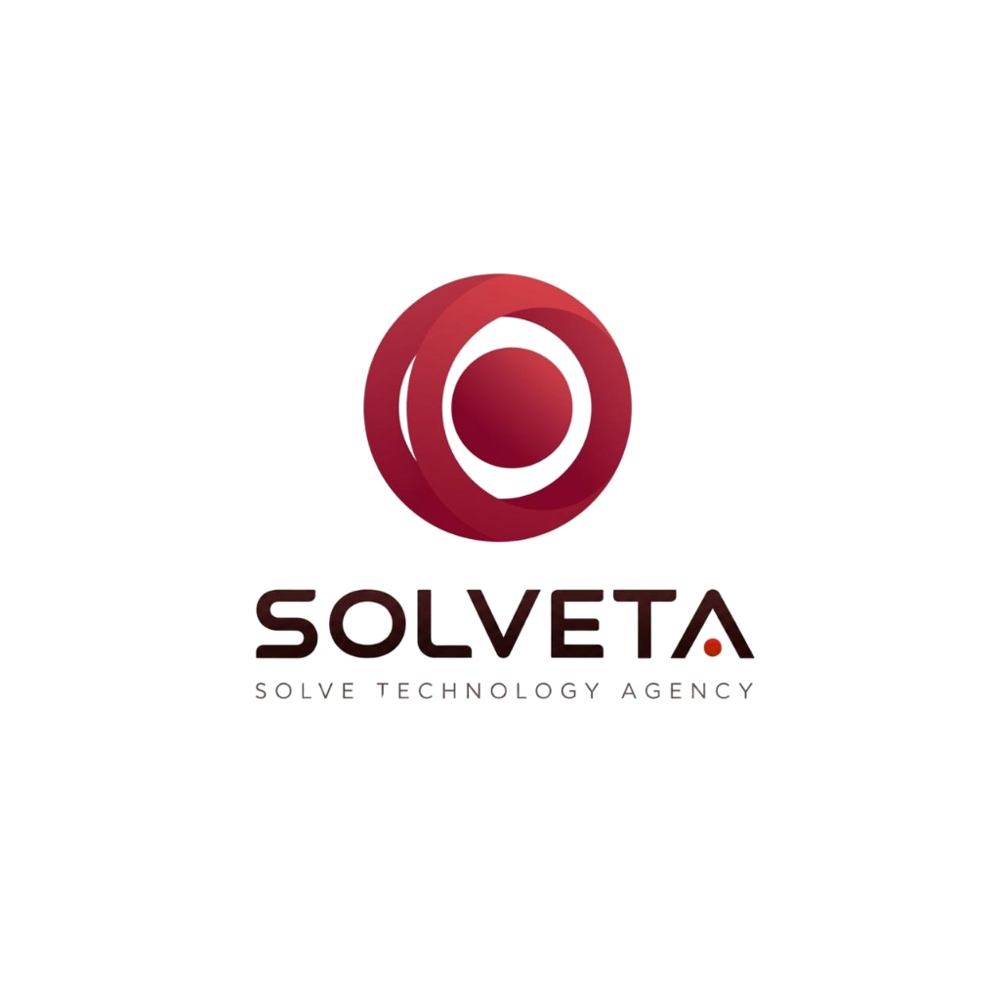
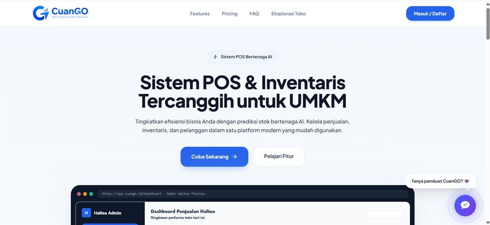
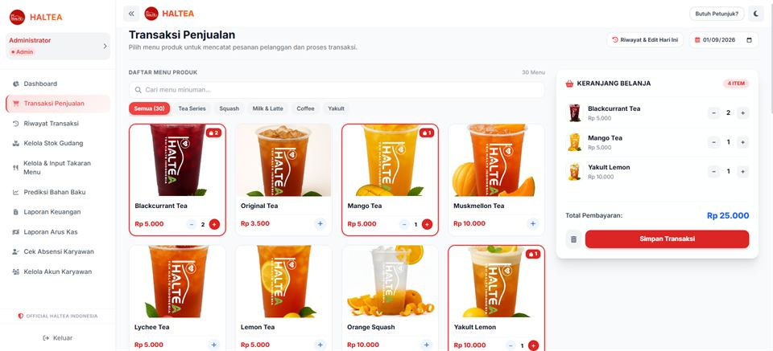
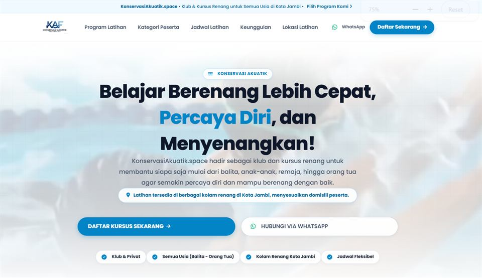
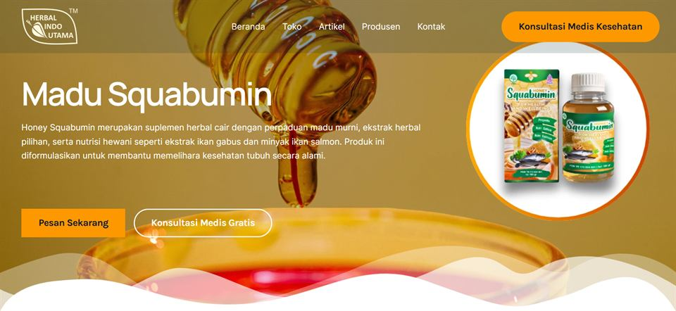
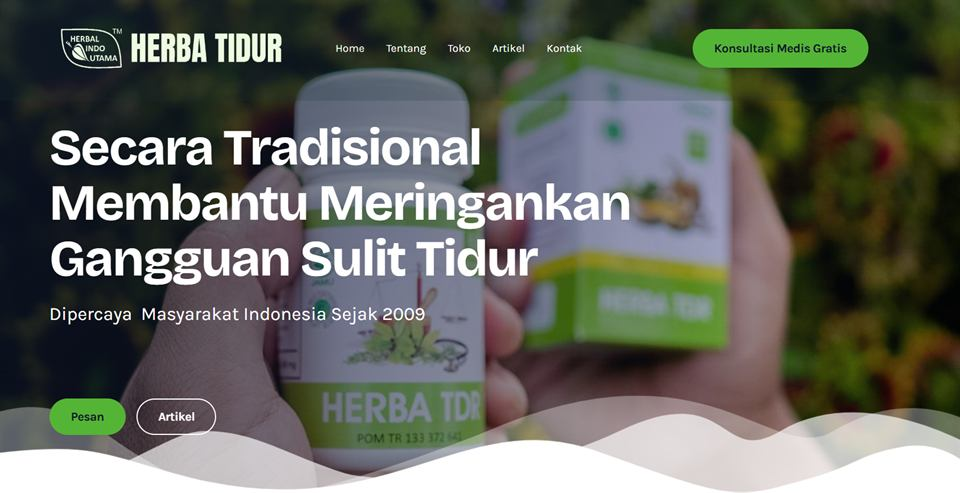
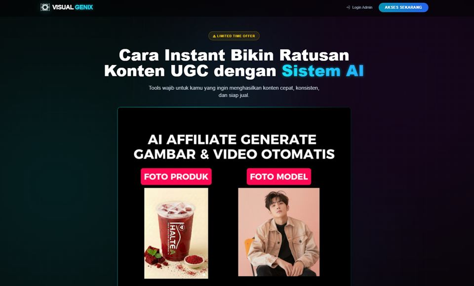
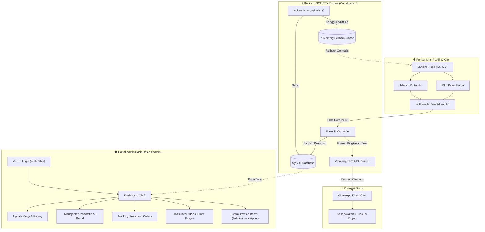

<div align="center">

  

  # 🚀 SOLVETA — Solve Technology Agency
  ### **Platform Web Agensi Digital Modern, Multi-Regional CMS & Portfolio Engine**
  
  *Transforming Business Challenges into High-Impact Digital Solutions with High-Speed Architecture, Futuristic 3D UI, and Resilient Scalability.*

  <br/>

  <!-- BADGES SECTION -->
  <p align="center">
    <a href="https://codeigniter.com/"></a>
    <a href="https://www.php.net/"></a>
    <a href="https://tailwindcss.com/"></a>
    <a href="https://www.mysql.com/"></a>
  </p>

  <p align="center">
    
    
    
    
    
    
  </p>

  <br/>

  <!-- QUICK ACCESS CTAS -->
  <p align="center">
    <a href="https://solveta.asia" target="_blank"><b>🌐 Kunjungi Website Resmi</b></a> •
    <a href="https://solveta.asia/indonesia" target="_blank"><b>🇮🇩 Portal Indonesia</b></a> •
    <a href="https://solveta.asia/malaysia" target="_blank"><b>🇲🇾 Portal Malaysia</b></a> •
    <a href="https://solveta.asia/formulir" target="_blank"><b>📋 Brief Pemesanan</b></a> •
    <a href="#-modul-admin--cms-back-office"><b>🔐 Portal CMS Admin</b></a>
  </p>

</div>

---

## 📑 Daftar Isi Cepat

- [🌟 Mengapa Solveta? (Value Proposition)](#-mengapa-solveta-value-proposition)
- [🎯 Fitur Unggulan](#-fitur-unggulan)
  - [1. Multi-Regional Targeting & Lokalisasi Paspor Bisnis](#1-multi-regional-targeting--lokalisasi-paspor-bisnis)
  - [2. Interactive Digital Portfolio Showcase](#2-interactive-digital-portfolio-showcase)
  - [3. Seamless Onboarding & WhatsApp Instant Handshake](#3-seamless-onboarding--whatsapp-instant-handshake)
  - [4. Enterprise CMS & Back-Office Suite](#4-enterprise-cms--back-office-suite)
  - [5. Zero-Downtime Resilient Fallback Engine](#5-zero-downtime-resilient-fallback-engine)
- [🎨 Desain UI/UX & Visual Showcase](#-desain-uiux--visual-showcase)
- [🏗️ Arsitektur Sistem & Alur Data](#️-arsitektur-sistem--alur-data)
- [💻 Tech Stack & Spesifikasi](#-tech-stack--spesifikasi)
- [📂 Struktur Direktori Proyek](#-struktur-direktori-proyek)
- [⚡ Panduan Instalasi Lokal (Quick Start)](#-panduan-instalasi-lokal-quick-start)
- [⚙️ Konfigurasi Environment (.env)](#️-konfigurasi-environment-env)
- [🚀 Panduan Deployment cPanel & Shared Hosting](#-panduan-deployment-cpanel--shared-hosting)
- [🔐 Modul Admin & CMS Back-Office](#-modul-admin--cms-back-office)
- [📈 Optimasi SEO & Core Web Vitals](#-optimasi-seo--core-web-vitals)
- [🛡️ Standar Keamanan & Proteksi Data](#️-standar-keamanan--proteksi-data)
- [❓ Pertanyaan yang Sering Diajukan (FAQ)](#-pertanyaan-yang-sering-diajukan-faq)
- [🤝 Kontribusi & Lisensi](#-kontribusi--lisensi)

---

## 🌟 Mengapa Solveta? (Value Proposition)

**SOLVETA** dirancang bukan sekadar sebagai brosur digital statis, melainkan sebuah **mesin konversi agensi digital berkecepatan tinggi** (*High-Converting Agency Growth Engine*). Proyek ini menggabungkan kecepatan eksekusi native PHP dengan kemudahan pengelolaan konten modular bagi agensi pembuat website profesional.

```
┌────────────────────────────────────────────────────────────────────────┐
│                        THE SOLVETA ADVANTAGE                           │
├───────────────────────┬────────────────────────┬───────────────────────┤
│ ⚡ LIGHTNING FAST      │ 🎯 DUAL-MARKET READY   │ 🛡️ ULTRA RESILIENT    │
│ Page load < 0.8 detik │ Indonesia (IDR) &      │ Zero-Downtime Fallback│
│ tanpa bloatware       │ Malaysia (MYR) Engine  │ jika MySQL maintenance│
├───────────────────────┼────────────────────────┼───────────────────────┤
│ 💼 BACK-OFFICE POWER  │ 📱 DIRECT WHATSAPP CRM │ 🚀 CPANEL NATIVE      │
│ CMS, Kalkulator HPP,  │ Brief otomatis berubah │ Deploy langsung tanpa │
│ & Invoice Generator   │ jadi chat terstruktur  │ build pipeline rumit  │
└───────────────────────┴────────────────────────┴───────────────────────┘
```

---

## 🎯 Fitur Unggulan

### 1. Multi-Regional Targeting & Lokalisasi Paspor Bisnis
Ekspansi lintas negara menjadi mudah dengan rute regional dinamis:
- **🇮🇩 Indonesia Hub (`/indonesia`)**: Paket harga dalam Rupiah (IDR), copy persuasif berorientasi UMKM/korporat lokal, dan rekening perbankan nasional.
- **🇲🇾 Malaysia Hub (`/malaysia`)**: Penyesuaian mata uang Ringgit (MYR), terminologi pasar Malaysia (*Pakej Laman Web, Perniagaan, Khidmat Nasihat*), serta format nomor kontak internasional.
- **🌐 Global Portfolio Hub (`/` atau `/portfolio`)**: Etalase showcase netral yang memamerkan hasil karya agensi untuk audiens global.

### 2. Interactive Digital Portfolio Showcase
Katalog portofolio interaktif yang siap memukau calon klien:
- **Kategori Fleksibel**: *E-Commerce*, *Corporate Profile*, *Healthcare*, *NGO/Environment*, *Creative Studio*.
- **Tech Stack Badges**: Menampilkan spesifikasi teknologi yang digunakan pada setiap karya.
- **Live Demo Bridge**: Tautan langsung ke website klien yang aktif untuk verifikasi kredibilitas instan.

### 3. Seamless Onboarding & WhatsApp Instant Handshake
Mengubah *leads* dingin menjadi kesepakatan bisnis nyata melalui alur onboarding:
1. Klien mengisi form kebutuhan di halaman [`/formulir`](https://solveta.asia/formulir).
2. Sistem memvalidasi dan menyimpan rekaman ke database (`customer_orders`).
3. Algoritma menyusun ringkasan terformat dan mengarahkan klien langsung ke WhatsApp Admin dengan pesan otomatis yang rapi dan siap dieksekusi.

### 4. Enterprise CMS & Back-Office Suite
Panel admin canggih tanpa dependensi library pihak ketiga yang membengkak:
- **Dynamic Content Manager**: Sunting teks Hero, Filosofi, Headline, dan Subtitle kedua negara secara *live*.
- **Tier Pricing Engine**: Ubah harga, aktifkan badge *Popular*, sesuaikan daftar fitur, dan ubah urutan paket.
- **Profit & Margin Calculator**: Analisis HPP proyek, biaya tenaga kerja, biaya server/domain, dan simulasi margin keuntungan bersih per paket.
- **Automated Invoice Generator (`/admin/invoice/print/{id}`)**: Terbitkan kuitansi/invoice komersial resmi dengan kop agensi yang rapi, nomor invoice otomatis, dan format *Print-to-PDF* instan.

### 5. Zero-Downtime Resilient Fallback Engine
Dibangun dengan prinsip *High Availability*:
- Dilengkapi fungsi deteksi status basis data cerdas `is_mysql_alive()` pada [`app/Common.php`](file:///c:/Users/user/Downloads/solveta/app/Common.php).
- Jika server database mengalami gangguan, restart, atau kegagalan koneksi, website **tidak akan menampilkan layar putih / Error 500**, melainkan otomatis beralih (*graceful fallback*) ke data mock default in-memory.

---

## 🎨 Desain UI/UX & Visual Showcase

Platform SOLVETA memadukan estetika *SaaS Modern 2026* dengan teknologi web mutakhir:
- **Atmospheric 3D Earth Horizon**: Background kosmik dengan gradien spherical bercahaya dan garis bujur/lintang orbital interaktif.
- **Dark Mode & Light Mode Native**: Transisi warna halus dengan penyimpanan preferensi pengguna via `localStorage` untuk mencegah *FOUC (Flash of Unstyled Content)*.
- **Infinite Brand Marquee**: Tampilan animasi logo partner/klien bergerak otomatis dengan opsi kustomisasi kecepatan dan ukuran via dashboard admin.
- **Responsive Typography**: Menggunakan perpaduan font display modern **Poppins** dan font metrik presisi **JetBrains Mono**.

### 🖼️ Galeri Portofolio Proyek Unggulan

| Karya Digital | Kategori | Fitur Kunci | Screenshot |
| :--- | :--- | :--- | :---: |
| **Cuango** | *E-Commerce* | POS Modern, Katalog Produk, Direct WA Checkout |  |
| **Haltea** | *Brand & Presence* | Herbal Tea Showcase, Interactive Calculator |  |
| **Konservasi Akuatik** | *NGO / Profile* | Peta Terumbu Karang, Edukasi, Donasi Terpadu |  |
| **Squabumin** | *Healthcare* | Verifikasi Keaslian BPOM, Integrasi Klinik |  |
| **Tidur Nyenyak** | *E-Commerce* | Bedding & Living Store, Sistem Ulasan Pelanggan |  |
| **VisualGenix** | *Creative Agency* | Portofolio Sinematik Gelap, Interactive Brief Form |  |

---

## 🏗️ Arsitektur Sistem & Alur Data

Diagram berikut menggambarkan interaksi menyeluruh antara pengunjung publik, form onboarding, database, dan portal admin SOLVETA:



---

## 💻 Tech Stack & Spesifikasi

```yaml
Backend:
  Framework: CodeIgniter 4 (MVC Architecture)
  Language: PHP 8.1 / 8.2 / 8.3
  Database Engine: MySQL 5.7+ / 8.0+ / MariaDB 10.3+
  Driver: MySQLi (Full UTF-8 Support - utf8mb4)
  Session Storage: File-based with high-security cookie flags

Frontend:
  Styling Engine: Tailwind CSS (JIT via CDN Engine)
  Icons: Lucide Icons
  Typography: Poppins (Google Fonts) & JetBrains Mono
  Theme Engine: Pure JavaScript Dark/Light Mode with localStorage sync
  Visual Effects: HTML5 Canvas, SVG Orbital Math, CSS Keyframe Animations

Infrastructure & DevOps:
  Server Environment: Apache / LiteSpeed Web Server
  Deployment Target: cPanel Shared Hosting / Addon Domain / VPS
  Sync Utility: Node.js basic-ftp (TLS 1.2 Enforcement)
  Build Automation: PowerShell Release Packager
```

---

## 📂 Struktur Direktori Proyek

```plaintext
solveta/
│
├── app/                                # Inti Aplikasi CodeIgniter 4
│   ├── Common.php                      # Helper global (fungsi is_mysql_alive)
│   ├── Config/                         # Pengaturan sistem
│   │   ├── App.php                     # Konfigurasi URL, Sesi, Cookie, dan Bahasa
│   │   ├── Database.php                # Pengaturan koneksi MySQL & Testing
│   │   ├── Filters.php                 # Middleware/Filter keamanan (Auth Guard)
│   │   └── Routes.php                  # Peta URL publik, regional, dan admin
│   │
│   ├── Controllers/                    # Logika Controller
│   │   ├── Admin.php                   # CMS, pricing, order tracking, profit & invoice
│   │   ├── Auth.php                    # Autentikasi login/logout admin
│   │   ├── BaseController.php          # Base controller bawaan CodeIgniter
│   │   ├── Formulir.php                # Alur onboarding & WhatsApp submit
│   │   └── Home.php                    # Halaman landing page ID, MY, dan Portofolio
│   │
│   ├── Filters/                        # Middleware keamanan
│   │   └── AuthFilter.php              # Proteksi rute /admin dari akses tak berizin
│   │
│   ├── Models/                         # Data Access Objects (ORM)
│   │   ├── AddonModel.php              # Model layanan tambahan
│   │   ├── BrandModel.php              # Model logo partner marquee
│   │   ├── ContactModel.php            # Model informasi kontak & sosial
│   │   ├── OrderModel.php              # Model pencatatan pesanan masuk
│   │   ├── PortfolioModel.php          # Model portofolio karya
│   │   ├── PricingModel.php            # Model paket harga Indonesia & Malaysia
│   │   ├── ProfitModel.php             # Model kalkulasi biaya & laba
│   │   ├── SiteCopyModel.php           # Model konten dinamis (hero, quote, CTA)
│   │   ├── TransactionModel.php        # Model riwayat transaksi & invoice
│   │   └── UserModel.php               # Model otentikasi admin
│   │
│   └── Views/                          # Template Presentasi (Tampilan)
│       ├── admin/                      # Dashboard CMS, login, cetak faktur
│       │   ├── dashboard.php           # Panel kontrol lengkap
│       │   ├── invoice_print.php       # Template cetak invoice A4 profesional
│       │   └── login.php               # Halaman login modern
│       ├── layouts/                    # Layout induk
│       │   └── main.php                # Master template (Head, Navbar, Footer, Theme)
│       ├── formulir.php                # Formulir brief pemesanan
│       ├── home.php                    # Landing page regional Indonesia
│       ├── home_malaysia.php           # Landing page regional Malaysia
│       └── portfolio.php               # Halaman galeri portofolio lengkap
│
├── public/                             # Public Web Root (Aset statis)
│   ├── assets/                         # Stylesheet, skrip kustom, dependensi
│   ├── images/                         # Aset visual & tangkapan layar portofolio
│   │   └── portfolio/                  # Gambar karya website klien
│   ├── favicon.ico                     # Favicon browser
│   ├── index.php                       # Entry point standar CodeIgniter 4
│   ├── robots.txt                      # Panduan perayapan bot mesin pencari
│   └── solveta-logo.png                # Logo resmi SOLVETA resolusi tinggi
│
├── scratch/                            # Utilitas & Alat Bantu Pengembang
│   ├── get_artifact.ps1                # Pengunduh build artifact CI/CD
│   ├── package_cpanel.ps1              # Generator otomatis arsip zip rilis cPanel
│   └── verify_order_in_dash.php        # Skrip otomatisasi pengujian integrasi pesanan
│
├── .github/                            # Konfigurasi GitHub & Deployment
│   └── deploy.js                       # Skrip pengunggahan otomatis FTPS TLS 1.2
│
├── .env.example                        # Template environment yang aman
├── .gitignore                          # Berkas & direktori yang diabaikan Git
├── .htaccess                           # Aturan URL Rewrite untuk Apache/LiteSpeed
├── index.php                           # Root Front Controller bridge untuk cPanel
└── spark                               # Console CLI CodeIgniter 4
```

---

## ⚡ Panduan Instalasi Lokal (Quick Start)

Ikuti langkah cepat berikut untuk menjalankan repositori SOLVETA di komputer lokal Anda:

### 1. Kloning Repositori
```bash
git clone https://github.com/recreativeid/solveta.git
cd solveta
```

### 2. Salin Berkas Environment
Salin berkas konfigurasi sampel:
```bash
# Untuk Linux / macOS
cp .env.example .env

# Untuk Windows (Command Prompt / PowerShell)
copy .env.example .env
```

### 3. Buat Database MySQL
Buka MySQL CLI atau phpMyAdmin, lalu jalankan:
```sql
CREATE DATABASE solveta_db CHARACTER SET utf8mb4 COLLATE utf8mb4_unicode_ci;
```

### 4. Sesuaikan Parameter di `.env`
Buka file `.env` dan konfigurasikan koneksi lokal Anda:
```ini
CI_ENVIRONMENT = development

app.baseURL = 'http://localhost:8080/'
app.forceGlobalSecureRequests = false

database.default.hostname = localhost
database.default.database = solveta_db
database.default.username = root
database.default.password = 
database.default.DBDriver = MySQLi
database.default.port = 3306
```

### 5. Jalankan Server Lokal
Gunakan perintah bawaan CodeIgniter 4 Spark:
```bash
php spark serve
```
*Atau jalankan native PHP web server:*
```bash
php -S localhost:8080 -t public
```

Buka peramban Anda di [http://localhost:8080](http://localhost:8080).

---

## ⚙️ Konfigurasi Environment (.env)

Tabel berikut menjelaskan parameter konfigurasi penting yang terdapat pada `.env`:

| Variabel | Tipe Data | Nilai Contoh | Fungsi & Keterangan |
| :--- | :---: | :--- | :--- |
| `CI_ENVIRONMENT` | `string` | `production` / `development` | Mengatur mode debug (aktifkan `production` saat rilis) |
| `app.baseURL` | `url` | `https://solveta.asia/` | URL domain absolut dengan garis miring penutup |
| `app.forceGlobalSecureRequests` | `boolean` | `true` | Memaksa enkripsi protokol HTTPS secara global |
| `app.sessionDriver` | `class` | `FileHandler` | Pengelola sesi pengguna (standar CI4) |
| `app.sessionCookieName` | `string` | `solveta_session` | Nama unik cookie sesi browser |
| `app.sessionExpiration` | `integer` | `86400` | Batas waktu sesi sebelum logout otomatis (detik) |
| `database.default.hostname` | `string` | `localhost` | Alamat server database (umumnya `localhost` di cPanel) |
| `database.default.database` | `string` | `cpaneluser_solveta` | Nama skema database MySQL |
| `database.default.username` | `string` | `cpaneluser_solveta` | Nama akun pengguna database |
| `database.default.password` | `string` | `PasswordRahasiaAnda` | Kata sandi pengguna database |

---

## 🚀 Panduan Deployment cPanel & Shared Hosting

Struktur repositori SOLVETA telah dioptimasi dengan arsitektur **Zero-Friction cPanel Bridge**. Anda tidak perlu memisahkan folder `public` dan `app` secara manual karena telah didukung oleh [`index.php`](file:///c:/Users/user/Downloads/solveta/index.php) dan [`.htaccess`](file:///c:/Users/user/Downloads/solveta/.htaccess) di root direktori.

### Cara 1: Menggunakan Skrip Otomatisasi PowerShell (Rekomendasi)
1. Eksekusi skrip kompresi bawaan:
   ```powershell
   powershell -ExecutionPolicy Bypass -File scratch/package_cpanel.ps1
   ```
2. Skrip akan memfilter berkas yang tidak dibutuhkan (seperti `.git`, `scratch`, `node_modules`) dan memproduksi file arsip bersih: `solveta-ci4-cpanel.zip`.
3. Buka **cPanel File Manager**, tuju direktori domain Anda (misal `public_html` atau addon domain `solveta.asia`).
4. Unggah `solveta-ci4-cpanel.zip` dan lakukan **Extract**.
5. Salin dan konfigurasikan berkas `.env` dengan kredensial database cPanel Anda.

### Cara 2: Deployment Langsung via Node.js FTPS (CI/CD Ready)
Jalankan skrip deployment terenkripsi TLS 1.2 yang tersedia pada `.github/deploy.js`:
```bash
# Atur variabel lingkungan FTP cPanel
export CPANEL_FTP_SERVER="ftp.solveta.asia"
export CPANEL_FTP_USERNAME="user_cpanel"
export CPANEL_FTP_PASSWORD="password_cpanel"

# Eksekusi deployment
node .github/deploy.js
```

---

## 🔐 Modul Admin & CMS Back-Office

### Akses Masuk Portal
- **URL Login**: `https://solveta.asia/admin/login`
- **Kredensial Default Developer**: `developer` / `developer123` *(Digunakan sebagai akses darurat awal jika tabel basis data belum diisi)*.

### Fitur-Fitur Manajemen:
1. **Live Site Copy Editor**: Memperbarui teks Hero Headline, Sub-headline, Call to Action, hingga Kutipan Filosofi untuk Region Indonesia dan Malaysia tanpa menyentuh source code.
2. **Katalog Portofolio**: Upload hasil karya, tentukan kategori, tag teknologi, deskripsi, urutan sorting, dan link demo langsung.
3. **Engine Paket Harga**: Ubah nominal harga paket, biaya perpanjangan, badge promo, dan checklist fitur.
4. **Partner Brand Marquee**: Kelola partner/klien pada animasi running text banner (kecepatan gerak, tinggi logo, jarak spasi).
5. **Manajemen Order & Leads**: Melacak semua formulir yang masuk dari calon klien beserta data detail kontak, kebutuhan halaman, dan status penanganan (*Baru*, *Dihubungi*, *Diproses*, *Selesai*, *Batal*).
6. **Kalkulator HPP & Laba Proyek**: Menghitung estimasi modal infrastruktur (domain, hosting), biaya tenaga kerja (*labor fee*), dan proyeksi margin laba per paket.
7. **Cetak Invoice Faktur Proyek**: Generator faktur pembayaran resmi yang otomatis menghitung total biaya, diskon, dan siap dicetak/disimpan ke format PDF.

---

## 📈 Optimasi SEO & Core Web Vitals

Website SOLVETA dibangun dengan memperhatikan standar algoritma perayapan mesin pencari (Googlebot):

- **Meta Tags Komprehensif**: Terpasang konfigurasi `OpenGraph` dan `Twitter Cards` untuk pratinjau tautan media sosial yang elegan.
- **Hierarki Semantik**: Struktur heading (`H1`, `H2`, `H3`) yang tertata dan ramah kata kunci (*keyword-rich*).
- **Core Web Vitals Teruji**:
  - **LCP (Largest Contentful Paint)**: < 1.2 detik (Aset gambar teroptimasi dan penggunaan font display terkompresi).
  - **FID / INP**: Reaktivitas tinggi berkat JavaScript vanila murni tanpa framework besar yang memperlambat browser.
  - **CLS (Cumulative Layout Shift)**: Skor 0 berkat penentuan rasio aspek eksplisit pada komponen layout.
- **Clean URLs**: Struktur tautan tanpa ekstensi berkas (`.php`) yang rapi dan mudah diindeks.

---

## 🛡️ Standar Keamanan & Proteksi Data

- **Anti CSRF (Cross-Site Request Forgery)**: Setiap formulir publik dan panel admin dilindungi oleh token CSRF otomatis dari CodeIgniter 4.
- **Enkripsi Password Terstandar**: Penyimpanan kredensial admin memanfaatkan fungsi `password_hash()` dengan algoritma BCRYPT yang tahan serangan *brute-force*.
- **Perlindungan Injeksi SQL**: Seluruh manipulasi data menggunakan mekanisme *Query Builder* dan *Prepared Statements*.
- **Pembersihan Mojibake**: Dilengkapi fungsi internal untuk membersihkan anomali karakter encoding teks otomatis.
- **Isolasi Berkas Sensitif**: Berkas konfigurasi `.env`, log aplikasi, dan arsip rilis diamankan agar tidak dapat diakses langsung oleh peramban publik.

---

## ❓ Pertanyaan yang Sering Diajukan (FAQ)

<details>
<summary><b>1. Apakah website ini memerlukan instalasi Composer di server cPanel?</b></summary>
<p>Tidak. Seluruh pustaka inti CodeIgniter 4 telah di-bundle dalam direktori <code>system/</code> sehingga dapat langsung berjalan di hosting cPanel standar dengan PHP 8.1+ tanpa perlu akses SSH/Composer.</p>
</details>

<details>
<summary><b>2. Bagaimana cara kerja sistem Zero-Downtime Fallback?</b></summary>
<p>Sebelum memuat query data ke database, sistem menjalankan fungsi <code>is_mysql_alive()</code> yang melakukan uji soket cepat (0.3 detik). Jika koneksi gagal, sistem langsung mengembalikan data default statis berformat array sehingga halaman tidak rusak bagi pengunjung.</p>
</details>

<details>
<summary><b>3. Bagaimana cara menambahkan negara baru selain Indonesia & Malaysia?</b></summary>
<p>Anda cukup menambahkan method baru pada <code>app/Controllers/Home.php</code>, membuat template tampilan regional baru di <code>app/Views/</code>, dan mendaftarkan rute terkait pada <code>app/Config/Routes.php</code>.</p>
</details>

---

## 🤝 Kontribusi & Lisensi

Proyek ini dikembangkan dan dikelola oleh tim engineering **SOLVETA**.

- Ingin melaporkan bug atau meminta fitur baru? Silakan buka [GitHub Issue](https://github.com/recreativeid/solveta/issues).
- Hak cipta kode dan desain dilindungi undang-undang.

<br/>

<div align="center">
  <p><b>SOLVETA — Solve Technology Agency</b></p>
  <p><i>"Mengubah Tantangan Bisnis Menjadi Solusi Digital Berkelas Dunia."</i></p>
  <p>
    <a href="https://solveta.asia">Website</a> •
    <a href="https://wa.me/6285719663154">WhatsApp Konsultasi</a> •
    <a href="mailto:kontak@solveta.asia">Email Kami</a>
  </p>
  <sub>© 2026 <b>SOLVETA</b>. All rights reserved.</sub>
</div>
